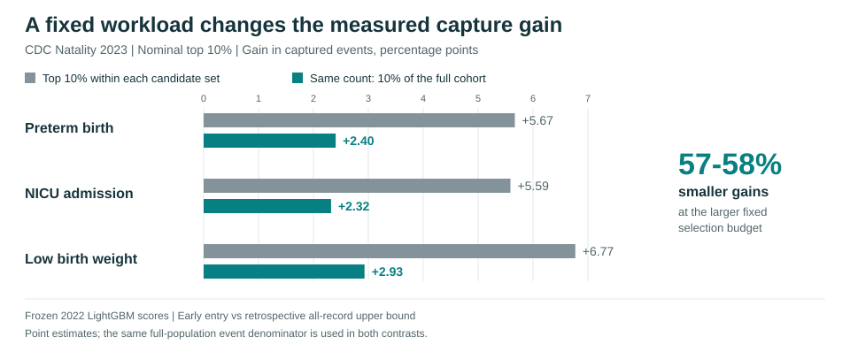

# Same Top Fraction, Different Workload: Auditing Eligibility and Capacity in Clinical Risk Evaluation

**TAE (Trust-AI-Eval), NeurIPS 2026 | Accepted poster, non-archival**

Vache Oganisyan, Dmitry Lvov, Ilya Pershin

[**NeurIPS project page**](https://neurips.cc/virtual/2026/loc/sydney/178202) |
[Paper and reviews](https://openreview.net/forum?id=puYbvC47rw) |
[Slides](https://neurips.cc/media/neurips-2026/Slides/178202.pdf) |
[Poster](https://neurips.cc/media/PosterPDFs/NeurIPS%202026/178202.png) |
[Models](pretrained/) |
[Reproduction guide](docs/reproduce.md)

Clinical risk scores turn patient rankings into finite worklists. Taking the
top 10% of differently sized eligible groups changes both who can be selected
and how many people are selected. This repository implements a four-cell audit
that separates those changes while keeping the risk scores and the denominator
of all population events fixed.



At the larger fixed selection budget, the CDC 2023 capture gains are **57-58%
smaller** than in the same-top-10% comparison. For preterm birth, the original
comparison selects 260,106 versus 348,038 records: **33.8% more selections**.
Holding both scenarios at 348,038 selections reduces the gain from **5.67 to
2.40 percentage points**. These are differences in captured events, not changes
in model accuracy or measured clinical benefit.

[Quick start](#quick-start) | [Study design](#study-design) |
[Repository map](#repository-map) | [Results](#results) | [Citation](#citation)

## Quick start

Python 3.12, CPU only. Run commands from the repository root.

```bash
git clone https://github.com/vache4ogan/prenatal-risk-scoreability.git
cd prenatal-risk-scoreability
python -m venv .venv
```

Activate with `source .venv/bin/activate` on Linux/macOS or
`.\.venv\Scripts\Activate.ps1` in PowerShell, then:

```bash
python -m pip install -r requirements.txt
python -m pytest -q
python scripts/experiments/run_tae_synthetic_shapley81.py --config configs/canonical/synthetic_experiment_shapley81.yaml --output-dir results/local_smoke --smoke-test
```

Tests and the small simulation run without CDC files or external service accounts.
Use a new output directory for each simulation or evaluation run. The smoke run
checks the full 81-condition design with two small replicates; it does not
reproduce the published 100-replicate estimates.

For the actual CDC experiments, follow the [reproduction guide](docs/reproduce.md):
obtain public-use data, reconstruct the canonical inputs, and evaluate the
[three released models](pretrained/). Retraining is optional.

## Study design

- **One frozen ranking per outcome:** LightGBM scores for preterm birth, NICU
  admission, and birth weight below 2,500 g.
- **Two eligibility rules:** early care entry in months 1-3, and all records as
  a retrospective upper bound. The additional any-care scenario uses months 1-10.
  No-care and unknown-care records enter only the all-record scenario.
- **Two absolute budgets:** the counts implied by 5% or 10% of the early and full
  cohorts. Crossing eligibility and budget gives four cells; symmetric Shapley
  effects allocate the joint contrast between eligibility and capacity.
- **One population-event denominator:** events outside the eligible group remain
  in the denominator. Paired full-size bootstrap resamples keep scores and
  observed absolute budgets fixed.

Models, preprocessing, and score thresholds are fit on **CDC 2022**.
**CDC 2023** supports hypothesis development and temporal evaluation;
**CDC 2024** is the locked temporal replication. The study population is
US-resident singleton births with the relevant outcome observed.

Care-entry eligibility comes from documented prenatal-care month. The score
inputs are retrospective birth-certificate fields; the audit does not establish
prospective EHR availability or the effect of a clinical intervention.

## Repository map

| Path | Contents |
| --- | --- |
| [scripts/preprocessing/](scripts/preprocessing/) | CDC fixed-width extraction and harmonization |
| [scripts/experiments/](scripts/experiments/) | Model fitting, four-cell audit, threshold transport, calibration helpers, simulation |
| [pretrained/](pretrained/) | Three native LightGBM models, preprocessing parameters, frozen thresholds |
| [configs/canonical/](configs/canonical/) | Feature sets, seeds, populations, and simulation design |
| [results/reference/](results/reference/) | Published aggregate results and bootstrap/simulation replicates |
| [tests/](tests/) | Protocol, extraction, model-loading, result-integrity, and documentation checks |

Individual birth records and patient-level predictions are not distributed here.
Obtain the **US** files for 2022-2024 from the
[official CDC/NCHS data portal](https://www.cdc.gov/nchs/data_access/vitalstatsonline.htm);
the [guide](docs/reproduce.md#data) explains the expected inputs.

## Results

- [CDC 2023](results/reference/2023/): cohort flow, four-cell contrasts, Shapley
  effects, protocol comparisons, and transported 2022 thresholds.
- [Locked CDC 2024 replication](results/reference/2024/): the same frozen models
  and thresholds applied to a later year.
- [Sensitivity analyses](results/reference/sensitivity/): removal of race and
  PRIORTERM from the feature set.
- [Full synthetic grid](results/reference/synthetic/): 81 conditions and 100
  independent replicates per condition.

[Reference checksums](results/reference/SHA256SUMS) and
[model checksums](pretrained/SHA256SUMS) identify the released bytes.
The tests check the aggregate accounting identities and the model interfaces.
Tests comparing native models with original joblib bundles are opt-in; see the
[model documentation](pretrained/README.md#loading).

## Citation

Use [CITATION.cff](CITATION.cff), or GitHub's **Cite this repository** button, for
the associated paper. The publication is a non-archival poster at the TAE workshop
at NeurIPS 2026.

## License

Code and the three released models are [MIT licensed](LICENSE). CDC/NCHS data,
the associated article, and dependencies retain their separate terms. See the
[NCHS data-use agreement](https://www.cdc.gov/nchs/policy/data-user-agreement.html).
